<picture>
  <source media="(max-width: 560px) and (prefers-color-scheme: dark)" srcset="assets/hero-narrow-dark.svg">
  <source media="(max-width: 560px) and (prefers-color-scheme: light)" srcset="assets/hero-narrow-light.svg">
  <source media="(prefers-color-scheme: dark)" srcset="assets/hero-wide-dark.svg">
  <source media="(prefers-color-scheme: light)" srcset="assets/hero-wide-light.svg">
  
</picture>

## 我怎么干活

1. 我把要什么写成几句话。
2. AI 写。
3. 我验收，验收不过就退回去重写。

gameboost 是一个晚上提交 12 次改出来的。pi-desktop-genui 到现在还是第一次提交那一版，我没再动过。写得快，不代表都收尾了。

## 最近在折腾

- [**gameboost**](https://github.com/GzxingR/gameboost) — PowerShell 冻结 / 还原游戏进程，12 次提交
- [**Translator-NeoForge**](https://github.com/GzxingR/Translator-NeoForge) — NeoForge 游戏内翻译，15 次提交
- [**pi-desktop-genui**](https://github.com/GzxingR/pi-desktop-genui) — JSON 规格 → 可交互组件，还是第一版
- [**ARTEX**](https://github.com/GzxingR/ARTEX) — fork 自 Autumn-27/ARTEX，AI 自主渗透，我还在读它的实现

## 最近提交

<!-- BEGIN:RECENT -->
| 仓库 | 说明 | 最近推送 |
| :--- | :--- | :--- |
| [portdeck](https://github.com/GzxingR/portdeck) | 本机端口总控台 — 一眼看清每个端口在干什么，并且能直接点开。零依赖 Node 服务 + 自动识别用途。 | 2026-11-14 |
| [dsh-aesthetic-library](https://github.com/GzxingR/dsh-aesthetic-library) | DSH (DeepSeek Harness) plugin: 审美库 Tab + @ trigger, wrapping code-animation-prompts (341 styles). Integration code only; no upstream assets bundled. | 2026-11-13 |
| [modao-open](https://github.com/GzxingR/modao-open) | Zero-dependency MIT mobile prototyping workbench in the browser: device canvas, 16 components, drag/resize/snap, click interactions, live preview, PNG/JSON export, BYO API key AI. | 2026-11-12 |
| [gallery-2048](https://github.com/GzxingR/gallery-2048) | 2048 云上挑战：9.6KB 单文件零依赖游戏，键盘 + 手势双操作，localStorage 持久化最高分 | 2026-10-22 |
| [gameboost](https://github.com/GzxingR/gameboost) | 游戏前冻结后台进程、玩完精确还原：NtSuspendProcess 真冻结 + 工作集回收 + QoS 快照，零依赖 PowerShell 5.1 + WinForms | 2026-10-13 |
<!-- END:RECENT -->

## 这页怎么更新

上面那张图就是仓库里的 SVG，不是什么截图服务生成的，改配色和文案重出一遍就行。下面的提交记录由 Actions 每天同步一次。

## 联系

任意一个公开仓库开 issue 就行，说清楚想聊什么。
