<picture>
  <source media="(max-width: 560px) and (prefers-color-scheme: dark)" srcset="assets/hero-narrow-dark.svg">
  <source media="(max-width: 560px) and (prefers-color-scheme: light)" srcset="assets/hero-narrow-light.svg">
  <source media="(prefers-color-scheme: dark)" srcset="assets/hero-wide-dark.svg">
  <source media="(prefers-color-scheme: light)" srcset="assets/hero-wide-light.svg">
  
</picture>

## 我怎么干活

1. 我把要什么写成几句话。
2. AI 写。
3. 我验收，验收不过就退回去重写。

pi-desktop-genui 从第一版到现在改了几轮，删掉的组件比留下的多。

## 最近在折腾

- [**ARTEX**](https://github.com/GzxingR/ARTEX) — AI 自主渗透，fork 后本地化
- [**gameboost**](https://github.com/GzxingR/gameboost) — PowerShell 冻结 / 还原游戏进程
- [**pi-desktop-genui**](https://github.com/GzxingR/pi-desktop-genui) — JSON 规格 → 可交互组件
- [**Translator-NeoForge**](https://github.com/GzxingR/Translator-NeoForge) — NeoForge 游戏内翻译

## 最近提交

<!-- BEGIN:RECENT -->
| 仓库 | 说明 | 最近推送 |
| :--- | :--- | :--- |
| [xuexi-power](https://github.com/GzxingR/xuexi-power) | 成绩管理系统：Next.js + Prisma 全栈实现，含桌面端封装与数据模型 | 2026-10-28 |
| [gallery-2048](https://github.com/GzxingR/gallery-2048) | 2048 云上挑战：9.6KB 单文件零依赖游戏，键盘 + 手势双操作，localStorage 持久化最高分 | 2026-10-22 |
| [gameboost](https://github.com/GzxingR/gameboost) | 游戏前冻结后台进程、玩完精确还原：NtSuspendProcess 真冻结 + 工作集回收 + QoS 快照，零依赖 PowerShell 5.1 + WinForms | 2026-10-13 |
| [pi-desktop-genui](https://github.com/GzxingR/pi-desktop-genui) | dsh-genui 的 PI-Desktop 移植：把 dsh-ui JSON 规格渲染成真实可交互组件，44 种组件类型 + 手写 SVG 图表 + 动作回传模型 | 2026-09-22 |
| [lms-web-mechanics-lab](https://github.com/GzxingR/lms-web-mechanics-lab) | 传统 SSR 在线学习平台的机制只读研究笔记：多子域架构、SSO 与请求签名、表单数据模型、前端反自动化设计 | 2026-09-02 |
<!-- END:RECENT -->

## 这页怎么更新

上面那张图是我自己画的 SVG，就躺在 `assets/` 里，不经过任何第三方统计服务。下面的提交记录由 Actions 每天同步一次。

## 联系

GitHub 任意一个公开仓库开 issue 就行，或者发邮件到 [gzxing_in@163.com](mailto:gzxing_in@163.com)。
