<picture>
  <source media="(prefers-color-scheme: dark)" srcset="assets/hero-dark.svg">
  <source media="(prefers-color-scheme: light)" srcset="assets/hero-light.svg">
  
</picture>

## 最近在折腾

| 东西 | 一句话 | 状态 |
| :--- | :--- | :--- |
| [**ARTEX**](https://github.com/GzxingR/ARTEX) | AI 自主渗透测试系统，正拆开改成本地能跑的版本 | 在拆 |
| [**gameboost**](https://github.com/GzxingR/gameboost) | 游戏前冻结后台进程，玩完精确还原，只碰自己冻过的 | 能用 |
| [**pi-desktop-genui**](https://github.com/GzxingR/pi-desktop-genui) | 把 JSON 规格渲染成 44 种可交互组件，图表手写 | 在造 |
| [**Translator-NeoForge**](https://github.com/GzxingR/Translator-NeoForge) | NeoForge 1.21.1 游戏内翻译，物品和界面文本实时英译中 | 在养 |

写废的比留下的多，留下的大多也不是我一行行敲的。

## 最近提交

<!-- BEGIN:RECENT -->
| 仓库 | 说明 | 最近推送 |
| :--- | :--- | :--- |
| [xuexi-power](https://github.com/GzxingR/xuexi-power) | 成绩管理系统：Next.js + Prisma 全栈实现，含桌面端封装与数据模型 | 2026-10-28 |
| [gallery-2048](https://github.com/GzxingR/gallery-2048) | 2048 云上挑战：9.6KB 单文件零依赖游戏，键盘 + 手势双操作，localStorage 持久化最高分 | 2026-10-22 |
| [gameboost](https://github.com/GzxingR/gameboost) | 游戏前冻结后台进程、玩完精确还原：NtSuspendProcess 真冻结 + 工作集回收 + QoS 快照，零依赖 PowerShell 5.1 + WinForms | 2026-10-13 |
| [pi-desktop-genui](https://github.com/GzxingR/pi-desktop-genui) | dsh-genui 的 PI-Desktop 移植：把 dsh-ui JSON 规格渲染成真实可交互组件，44 种组件类型 + 手写 SVG 图表 + 动作回传模型 | 2026-09-22 |
| [lms-web-mechanics-lab](https://github.com/GzxingR/lms-web-mechanics-lab) | 传统 SSR 在线学习平台的机制只读研究笔记：多子域架构、SSO 与请求签名、表单数据模型、前端反自动化设计 | 2026-09-02 |
<!-- END:RECENT -->

## 找我

想聊安全、Agent、或者单纯想找个搭子一起折腾点小东西，发邮件就行，不用客气。

- 邮箱：[gzxing_in@163.com](mailto:gzxing_in@163.com)
- 主页：https://github.com/GzxingR

这张对话图就存在仓库里，是 SVG 画的；下面的提交记录由 Actions 每天自动同步，不依赖第三方统计服务。
